---

## 👋 Presentación

Hola, soy **Cristhian Marcelo**, estudiante de **Desarrollo de Software** en **SENATI**, actualmente cursando el **5º ciclo**, y **becario PRONABEC (Beca 18)**.

Me apasiona construir soluciones que conectan el mundo digital con el físico: aplicaciones web, aplicaciones móviles y sistemas IoT. Estoy enfocado en crecer como desarrollador *full stack*, aprender de forma constante y llevar mis ideas a proyectos reales.

- 🎓 Desarrollo de Software (5º Ciclo) en SENATI
- 🏅 Becario PRONABEC (Beca 18)
- 🔭 Explorando la integración entre software, móviles y hardware
- 🌱 Mejorando cada día mis habilidades de backend, frontend y sistemas embebidos

---

## 🛠️ Stack Tecnológico

### 🌐 Frontend

### ⚙️ Backend & Base de Datos

### 📱 Mobile & IoT

---

## 📌 Estado Actual

---

